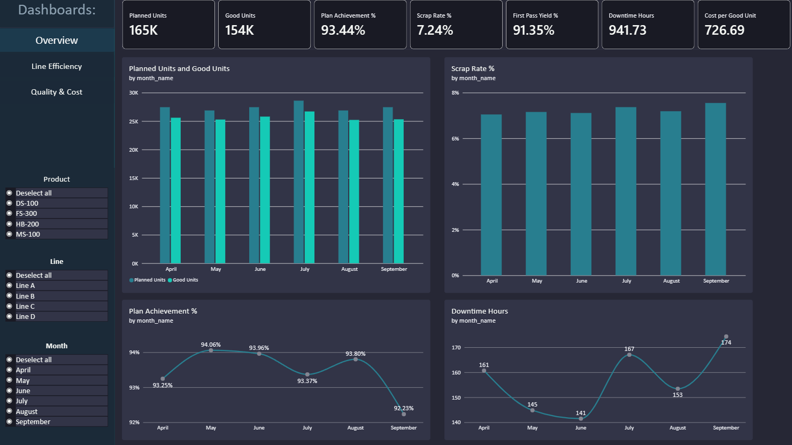
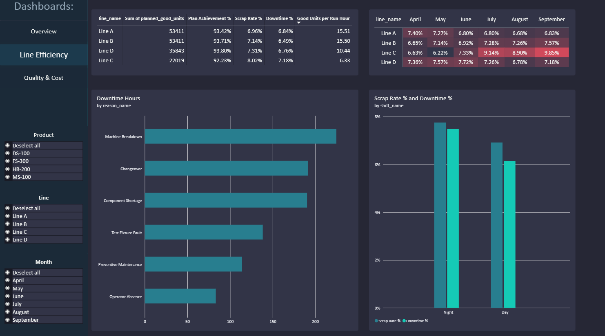
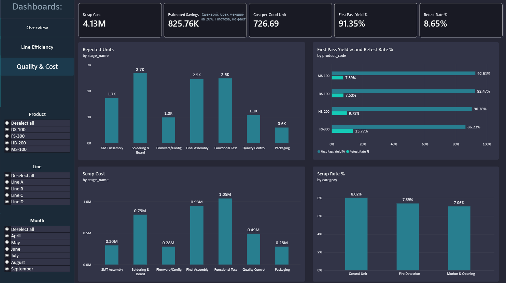

# Smart Security Devices Manufacturing Analytics

Навчальний pet project для портфоліо: наскрізна аналітика виробництва електронних пристроїв безпеки.

## Мета

Автоматизувати виробничу звітність і відповісти на питання керівництва:

| Питання | Де відповідь |
|---|---|
| Чи виконується план? | Dashboard Overview |
| На якому етапі найбільше дефектів? | Dashboard Quality & Cost |
| Які лінії мають найнижчий вихід придатних? | Dashboard Line Efficiency |
| Які причини простоїв найсильніше впливають? | Dashboard Line Efficiency |
| Скільки виробів проходять тест з першої спроби? | Overview, Quality & Cost (FPY) |
| Скільки коштує один придатний виріб? | Overview, Quality & Cost |
| Як відрізняються зміни? | Line Efficiency |
| Який ефект дасть зниження браку? | Quality & Cost (сценарна оцінка) |

## Стек

Python (pandas, numpy, pyodbc) · SQL Server / T-SQL · Power BI · DAX

## Архітектура

```
Python (генерація) → CSV → валідація → SQL Server → SQL views → Power BI
```

1. `gen_*.py` створюють синтетичні дані з фіксованим seed.
2. `validate_data.py` перевіряє зв'язки, інваріанти й контрольні суми (51 перевірка).
3. `load_to_sql.py` завантажує CSV у SQL Server (повторний запуск не створює дублів).
4. SQL-запити й views рахують KPI.
5. Power BI будує модель (зіркова схема), DAX-міри й три дашборди. Результати мір звірено з SQL.

## Модель даних

17 таблиць: 9 довідників і 8 таблиць фактів. Рівень окремого виробу (`units`, 165 885 рядків) і окремі спроби тестування (`test_results`, 177 558 рядків).

```
production_plan → work_orders → batches → units → test_results
                                                 → quality_inspections
downtime_records, production_costs  (залежать лише від довідників)
```

Ключові правила, щоб уникнути подвійного підрахунку:

- одиниця підрахунку це `unit_id`, а не рядок таблиці;
- виріб має **один** остаточний статус (`Good` або `Rejected`), навіть якщо мав кілька спроб тесту;
- дефект не дорівнює браку: виправлений дефект не робить виріб бракованим;
- перед з'єднанням кожну таблицю зводять до рівня виробу (CTE).

Опис усіх колонок: словник даних. Формули показників: [docs/kpi_catalog.md](docs/kpi_catalog.md).

## Ключові результати (синтетична симуляція)

| Показник | Значення |
|---|---|
| План придатних виробів | 164 684 |
| Випущено придатних | 153 881 |
| Виконання плану | 93.44% |
| Рівень браку (Scrap Rate) | 7.24% |
| First Pass Yield | 91.35% |
| Retest Rate | 8.65% |
| Простої | 941.7 год |
| Витрати на придатний виріб | 726.69 грн |
| Збитки від браку (лише матеріали) | 4 128 816 грн |





Деталі й рекомендації винесено в окремий документ «Бізнес-рекомендації».

## Структура репозиторію

```
mfg_analytics/
├── data/raw/                 CSV, створені скриптами
├── src/
│   ├── config.py             seed, період, шляхи
│   ├── gen_dimensions.py     довідники 1 (зміни, продукти, лінії, етапи, нормативи)
│   ├── gen_dimensions_2.py   довідники 2 (дефекти, причини простоїв, співробітники)
│   ├── gen_calendar_plan.py  календар і виробничий план
│   ├── gen_downtime.py       простої
│   ├── gen_orders_batches.py замовлення й партії (з урахуванням простоїв)
│   ├── gen_units.py          окремі вироби, брак за етапами
│   ├── gen_tests.py          спроби тестування
│   ├── gen_inspections.py    інспекції якості
│   ├── gen_costs.py          витрати
│   ├── validate_data.py      перевірки якості
│   └── load_to_sql.py        завантаження в SQL Server
├── sql/
│   ├── 01_create_tables.sql  таблиці, ключі, обмеження
│   └── 02_views.sql          представлення
├── docs/
│   ├── kpi_catalog.md        каталог KPI
│   └── validation_report.txt звіт валідації
├── powerbi/mfg_analytics.pbix
└── requirements.txt
```

## Інструкція запуску

**Потрібно:** Python 3.10+, SQL Server (підійде Developer Edition), SQL Server Management Studio, ODBC Driver 18 for SQL Server, Power BI Desktop.

### 1. Середовище

```
python -m venv .venv
.venv\Scripts\activate
pip install pandas numpy pyodbc
```

### 2. Генерація даних

Запускати з папки `src` строго в такому порядку, бо кожен скрипт читає файли попередніх:

```
python gen_dimensions.py
python gen_dimensions_2.py
python gen_calendar_plan.py
python gen_downtime.py
python gen_orders_batches.py
python gen_units.py
python gen_tests.py
python gen_inspections.py
python gen_costs.py
python validate_data.py
```

Очікування: `validate_data.py` виводить `Перевірок: 51 | Помилок: 0`. Той самий seed дає ті самі дані при кожному запуску.

### 3. База даних

1. У SSMS створіть базу `Mfg_Analytics`.
2. Виконайте `sql/01_create_tables.sql`, потім `sql/02_views.sql`.
3. У `src/load_to_sql.py` вкажіть ім'я свого сервера (рядок `SERVER=...`).
4. Запустіть `python load_to_sql.py`. Скрипт спершу очищає таблиці, потім завантажує CSV й порівнює кількість рядків із SQL.

### 4. Power BI

Відкрийте `powerbi/mfg_analytics.pbix`, у **Transform data → Data source settings** змініть сервер на свій і натисніть **Refresh**.

## Перевірки якості

- унікальність ключів у всіх таблицях фактів;
- відсутність «сиріт» (кожне посилання існує в довіднику);
- `Good + Rejected = усі вироби`; у Good немає етапу списання;
- не більше 3 спроб тесту, спроби йдуть без прогалин;
- тестувалися саме ті вироби, що дійшли до етапу 5;
- у Good остання спроба тесту Pass;
- Fail-інспекції лише у Rejected, Reworked лише у Good;
- контрольні суми по всіх таблицях;
- після завантаження: кількість рядків у SQL дорівнює CSV, а суми збігаються з Python;
- результати DAX-мір збігаються з SQL у зрізах за місяцями, продуктами й загалом.

## Закладені сценарії (ground truth)

У дані навмисно закладено п'ять історій, щоб перевірити, чи знаходить їх аналітика:

| Код | Історія |
|---|---|
| G1 | На лінії C брак пайки росте з 3-го місяця |
| G2 | У нічну зміну вищий брак на фінальному складанні й більше простоїв |
| G3 | У FS-300 більше повторних тестів |
| G4 | У 5-му місяці втручання знижує повторні тести на лінії C |
| G5 | Нестача деталей частіше на лінії C |

Оскільки історії закладені свідомо, «виявлено» означає, що метод аналізу працює, а не що це відкриття. У реальних даних причини заздалегідь невідомі.

## Обмеження

- Усі дані, ставки праці, склад бригади, накладні й ймовірності браку це **припущення**.
- У таблиці простоїв немає `product_id`: зв'язок простій → продукт іде через лінію. Для лінії D, де два продукти, він неточний, тому фільтр за продуктом не діє на простої.
- Витрати мають грейн «день × лінія × продукт», без зміни. Cost per Good Unit не можна коректно розрізати за змінами.
- Показник відхилення від нормативного часу не розраховано: є нормативи, але немає фактичного часу на виріб.
- Збитки від браку враховують лише матеріали.
- У моделі виріб після першої невдачі завжди йде на повторний тест, тому FPY + Retest Rate = 100%.
- Дата спроби тесту збігається з датою замовлення, без переходу через північ.
- Показник «штуки на годину» не порівнюваний між лініями, бо вони випускають продукти різної складності.
- Сценарій економії (20% зменшення браку) це гіпотеза, а не прогноз.

## Що не реалізовано

Автоматизація (журнал завантажень, захист від дублювання при надходженні нових записів, Google Sheets), приймання даних через FastAPI, сповіщення в Telegram і Airflow не виконані. Завантаження в SQL наразі повністю перезаписує таблиці, тому воно повторюваний, але не інкрементальний процес.
